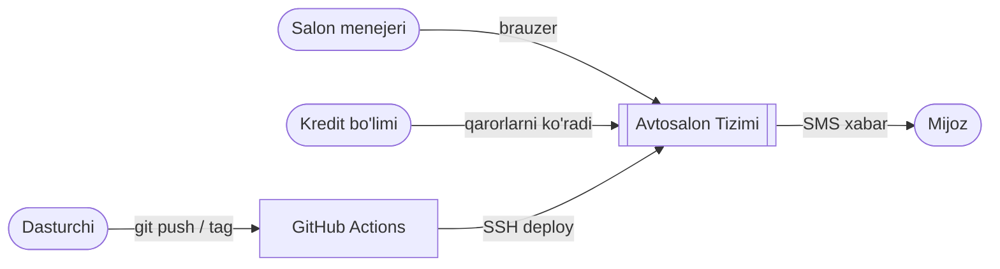
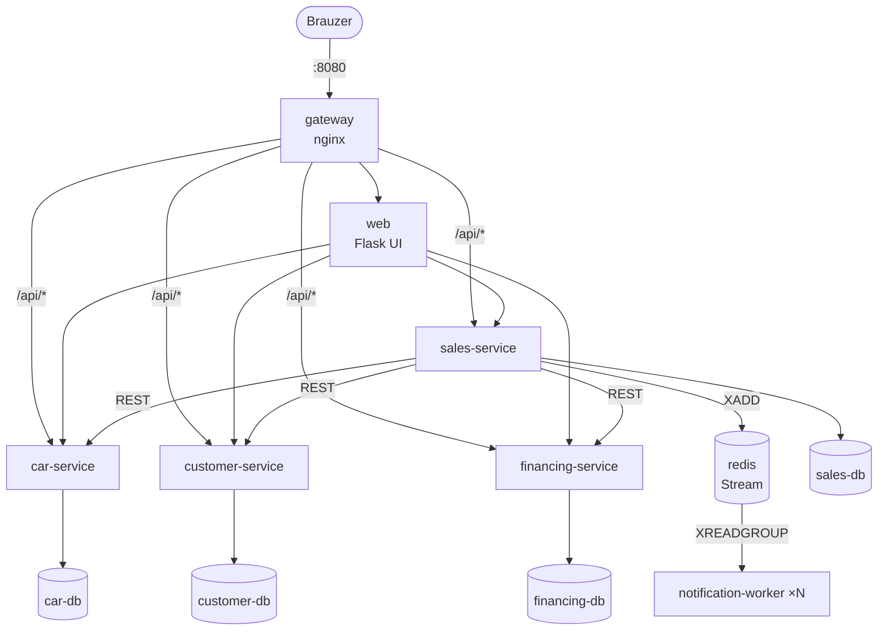
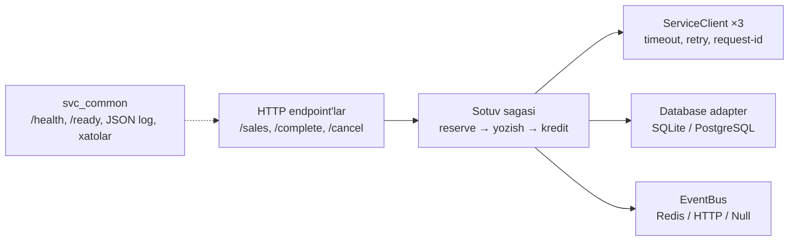
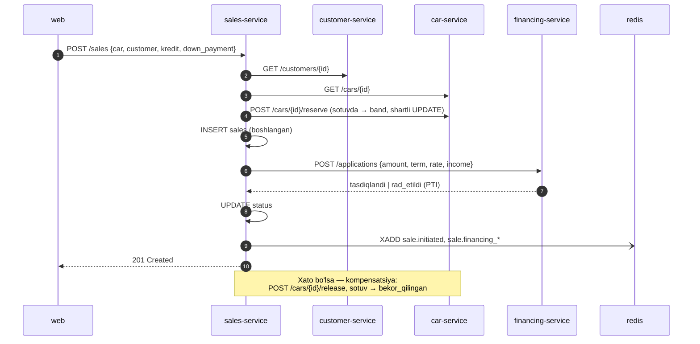
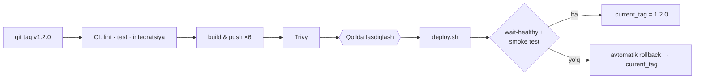

# Avtosalon Tizimi — arxitektura hujjati

> Yakuniy loyiha (Mavzu №30). Hujjat tuzilishi **arc42** shabloniga, diagrammalar **C4 modeli**ga asoslangan.
> Versiya 1.0.0 · Holat: himoyaga tayyor

---

## 1. Kirish va maqsadlar

**Muammo.** Avtosalonda avtomobillar ombori, mijozlar, sotuvlar va kredit arizalari alohida Excel jadvallarida yuritiladi. Natijada:
- bitta avtomobil ikki mijozga “sotilib” qoladi;
- kredit qarori qo'lda va sekin chiqariladi;
- mijozga holat haqida xabar berilmaydi.

**Yechim.** Sotuvni boshidan oxirigacha avtomatlashtiradigan veb-tizim:

| # | Biznes maqsad | O'lchov |
|---|---|---|
| G1 | Avtomobil faqat bitta sotuvga band qilinsin | Ikki marta band qilish hollari = 0 (shartli UPDATE + saga) |
| G2 | Kredit qarori darhol chiqsin | Qaror < 1 s (PTI ≤ 50 % qoidasi) |
| G3 | Mijoz har bir bosqichda xabardor bo'lsin | Har bir holat o'zgarishi → hodisa → SMS |
| G4 | Yangi versiya xavfsiz va tez chiqarilsin | Push → staging ≈ 10 daqiqa; muvaffaqiyatsiz deploy avtomatik qaytariladi |
| G5 | Har bir xodim faqat o'z vazifasiga kirsin | 3 rol, har bir o'zgarish audit jurnalida |
| G6 | Rahbariyat savdoni real vaqtda ko'rsin | Hisobotlar: tushum, konversiya, kredit tasdiqlash, voronka; CSV eksport |

**Asosiy sifat maqsadlari** (ustuvorlik tartibida):
1. **Ma'lumotlar yaxlitligi** — avtomobil holati va sotuv holati hech qachon bir-biriga zid bo'lmasligi kerak.
2. **Mustaqil rivojlantirish va deploy** — har bir servis alohida o'zgaradi va alohida deploy qilinadi.
3. **Ishonchlilik** — bitta servis yiqilsa, qolganlari ishlashda davom etadi va xato aniq ko'rinadi.
4. **Kuzatuvchanlik** — har bir so'rovni barcha servislar bo'ylab `X-Request-ID` orqali kuzatish mumkin.

**Manfaatdor tomonlar:** salon rahbari (hisobotlar), salon menejeri (sotuv), kredit bo'limi, mijoz (SMS oladi), DevOps (deploy), o'qituvchi (himoya).

## 2. Cheklovlar
- Til: Python 3.11+; kutubxonalar minimal (Flask, gunicorn, psycopg, redis).
- Infratuzilma: bitta Linux server, Docker Compose (Kubernetes talab qilinmaydi).
- Ma'lumotlar bazasi: PostgreSQL 16. Lokal ishlab chiqish va testlar uchun SQLite.
- Boshqa ma'lumotlar bazasiga to'g'ridan-to'g'ri ulanish taqiqlanadi (database-per-service).

## 3. Kontekst (C4 — 1-daraja)

## 4. Yechim strategiyasi

| Muammo | Qaror | ADR |
|---|---|---|
| Turli jamoalar, turli o'zgarish tezligi | Biznes-imkoniyatlar bo'yicha 4 ta mikroservis + worker | [ADR-0001](adr/0001-microservices-database-per-service.md) |
| Ma'lumotlar mustaqilligi | Har bir servisning o'z PostgreSQL bazasi | [ADR-0002](adr/0002-postgresql-per-service-sqlite-local.md) |
| Bir nechta servisni qamrab oladigan sotuv | Orkestratsiyalangan saga va kompensatsiya | [ADR-0003](adr/0003-saga-orchestration-for-sales.md) |
| Xabarnomalar sotuvni sekinlashtirmasin | Redis Streams orqali asinxron hodisalar | [ADR-0004](adr/0004-redis-streams-event-bus.md) |
| Yagona kirish, xavfsizlik, masshtablash | nginx API Gateway | [ADR-0005](adr/0005-nginx-api-gateway.md) |
| Oddiy, sinovdan o'tgan web stack | Flask + gunicorn | [ADR-0006](adr/0006-flask-gunicorn.md) |
| Kichik jamoa uchun boshqarish oson bo'lgan infratuzilma | Docker Compose (dev/prod override) | [ADR-0007](adr/0007-docker-compose-deployment.md) |
| Xavfsiz va tez reliz | GitHub Actions, GHCR, Trivy, avtomatik rollback | [ADR-0008](adr/0008-cicd-github-actions.md) |
| Muammoni tez topish | Metrikalar, taqsimlangan iz, saga jurnali, chaos sinovi | [ADR-0009](adr/0009-observability-tracing-chaos.md) |
| Faqat vakolatli xodim | Web (BFF) da login, RBAC, audit; gateway API kaliti | [ADR-0010](adr/0010-bff-authentication-rbac-audit.md) |

## 5. Qurilish bloklari

### 5.1 Konteynerlar (C4 — 2-daraja)

| Konteyner | Mas'uliyat | Ma'lumot egasi | Port (ichki) |
|---|---|---|---|
| **gateway** | Yagona kirish nuqtasi: marshrutlash, rate limit, `X-Request-ID`, xavfsizlik header'lari | — | 80 → 8080 |
| **web** | Menejer paneli; faqat API'lar orqali o'qiydi va yozadi | — | 8000 |
| **car-service** | Avtomobillar ombori, holatlar: sotuvda → band → sotilgan | `cars` | 8000 |
| **customer-service** | Mijozlar, telefon/pasport validatsiyasi, daromad | `customers` | 8000 |
| **sales-service** | Sotuv sagasi, to'lov tekshiruvi, hodisalarni nashr qilish | `sales` | 8000 |
| **financing-service** | Kredit arizasi, annuitet, PTI qarori, idempotentlik | `applications` | 8000 |
| **notification-worker** | Hodisalardan SMS matni, statistika; consumer group | xotira | 8000 |
| **redis** | Hodisalar oqimi (AOF bilan saqlanadi) | stream | 6379 |
| **4 × postgres** | Har bir servisning alohida bazasi | — | 5432 |

### 5.2 Servis ichki tuzilishi (C4 — 3-daraja, sales-service)

Umumiy kod `libs/svc_common` kutubxonasida joylashgan:
- `Database` — dialektlar farqini yashiradi (`?` → `%s`, `{pk}`);
- `ServiceClient` — HTTP klient;
- `EventBus` — hodisalar uchun;
- `create_service_app` — barcha servislar uchun bir xil Flask karkasi.

Har bir servis shu kutubxonaning nusxasini o'z image'iga oladi. Servislar runtime'da bir-biriga bog'liq emas.

## 6. Ish vaqtidagi ssenariylar

### 6.1 Kreditli sotuv (saga)

### 6.2 Asinxron xabarnoma
1. `sales-service` → `XADD avtosalon.events`.
2. `notification-worker` (`XREADGROUP`, group `notification-workers`) hodisani o'qiydi → SMS matnini tayyorlaydi → `XACK`.
3. Worker qulab tushsa, tasdiqlanmagan xabar *pending* holatida qoladi. Worker qayta ishga tushganda uni qayta o'qiydi.
4. Dublikat hodisalar hodisa ID'si bo'yicha tashlab yuboriladi (at-least-once + idempotentlik).

### 6.3 Deploy va rollback

## 7. Joylashtirish (deployment)

| Muhit | Qanday | Ma'lumotlar |
|---|---|---|
| Lokal (tez) | `./run_local.sh` — bitta jarayonda 5 servis va panel | SQLite fayllar, HTTP event bus |
| Lokal (to'liq) | `docker compose up -d --build` + `docker-compose.override.yml` | PostgreSQL ×4, Redis |
| CI | GitHub Actions: `docker compose -f docker-compose.yml up` + smoke test | vaqtinchalik volume'lar |
| Staging / Production | Serverda `deploy/deploy.sh`: image'lar GHCR'dan, `docker-compose.prod.yml` (read-only, cap_drop, limitlar) | named volume'lar, `.env` serverda |

Tarmoqlar:
- `frontend` — gateway;
- `backend` — servislar;
- `data` — bazalar (`internal: true`).

Bazalarga tashqaridan kirib bo'lmaydi.

## 8. Umumiy yechimlar (cross-cutting)

| Mavzu | Yechim |
|---|---|
| **Kuzatuvchanlik** | Uch ustun: **loglar** (JSON, `request_id` bilan), **metrikalar** (`/metrics` — Prometheus histogram, `/metrics.json`), **taqsimlangan iz** (`/traces`: har bir so'rov span sifatida; `ServiceClient` `X-Request-ID` va `X-Caller` ni avtomatik uzatadi, web ularni waterfall qilib birlashtiradi). Saga qadamlari `saga_steps` jadvalida (ADR-0009) |
| **Sog'liq** | `/health` (liveness: versiya, commit, konteyner nomi) va `/ready` (DB ulanishi). Compose healthcheck'lari va `depends_on: service_healthy` |
| **Xatolar** | Yagona JSON format `{"error": ..., "fields": {...}}`; 422 — validatsiya, 409 — holat ziddiyati, 503 — bog'liq servis ishlamayapti |
| **Konfiguratsiya** | Faqat muhit o'zgaruvchilari (12-factor). Parollar `.env` faylida, u git'ga qo'shilmaydi |
| **Kirish nazorati** | Web (BFF) da login, 3 rol (admin, menejer, kredit) va ruxsatlar (RBAC); parollar `werkzeug` hash; 5 xato → 5 daqiqa blok; session fixation va open redirect himoyasi; audit jurnali (ADR-0010) |
| **Barqarorlik sinovi** | Har bir servisda `/admin/chaos` (503 yoki kechikish) — kompensatsiya va timeout'larni jonli tekshirish; production'da o'chiq |
| **Xavfsizlik** | Non-root konteynerlar, `read_only`, `cap_drop: ALL`, `no-new-privileges`, ichki `data` tarmog'i, rate limit, Trivy skaner, CSRF (web), xavfsizlik header'lari (`X-Frame-Options`, `nosniff`), CSV-injection himoyasi, parametrlangan SQL |
| **Bir vaqtdagi so'rovlar** | Avtomobil holati shartli `UPDATE ... WHERE status = ?` orqali o'zgaradi — race condition bo'lmaydi |
| **Idempotentlik** | `financing-service`: bitta `sale_ref` uchun bitta ariza; worker: hodisa ID'lari |

## 9. Arxitektura qarorlari
To'liq ro'yxat — [`docs/adr/`](adr/). Har bir ADR quyidagi tartibda yozilgan: *Kontekst → Qaror → Muqobillar → Oqibatlar*.

## 10. Sifat ssenariylari

| ID | Atribut | Ssenariy | Javob / o'lchov | Qanday ta'minlanadi |
|---|---|---|---|---|
| Q1 | Yaxlitlik | Ikki menejer bir avtomobilni bir vaqtda sotmoqchi | Ikkinchisi 409 oladi | Shartli UPDATE, test: `test_car_service_crud_and_transitions` |
| Q2 | Ishonchlilik | Sotuv paytida financing-service ishlamayapti | 503; avtomobil bo'shatiladi; sotuv `bekor_qilingan` | Saga kompensatsiyasi, test: `test_compensation_when_financing_down` |
| Q3 | Ishonchlilik | notification-worker qulab tushdi | Hodisalar yo'qolmaydi, qayta ishga tushganda yetkaziladi | Redis Streams pending + AOF, test: `test_consumer_group_ack_and_redelivery` |
| Q4 | Masshtablash | Yuklama 3 barobar oshdi | `--scale car-service=3`, gateway taqsimlaydi | Stateless servislar, nginx DNS round-robin |
| Q5 | Deploy xavfsizligi | Yangi versiya health check'dan o'tmadi | Oldingi versiya avtomatik qaytariladi | `deploy/deploy.sh` |
| Q6 | O'zgaruvchanlik | Kredit qoidasi o'zgardi (PTI 40 %) | Faqat financing-service qayta deploy qilinadi | Database-per-service, API shartnomasi |
| Q7 | Xavfsizlik | Image'da CRITICAL zaiflik bor | Pipeline to'xtaydi, deploy qilinmaydi | Trivy `exit-code: 1` |
| Q8 | Xavfsizlik | “Kredit mutaxassisi” sotuv yaratmoqchi | 403, urinish audit jurnalida | RBAC, test: `test_login_required_and_rbac` |
| Q9 | Xavfsizlik | Parolni terib topish (brute force) | 5 xatodan keyin 5 daqiqa blok | `LoginThrottle`, test: `test_password_hashing_and_throttle` |
| Q10 | Kuzatuvchanlik | “Sotuv nega sekin / nega bekor bo'ldi?” | Bir necha soniyada sabab topiladi | Saga izi + waterfall, test: `test_chaos_triggers_compensation_and_saga_log` |
| Q11 | Ishlatish qulayligi | Menejer kreditga ariza berishdan oldin natijani bilmoqchi | Oylik to'lov va PTI formada darhol ko'rinadi | Kalkulyator financing-service bilan bir xil formuladan foydalanadi |

## 11. Xavflar va texnik qarz

| Xavf / qarz | Ta'sir | Yumshatish / reja |
|---|---|---|
| Sinxron REST zanjiri (sales → 3 servis) | Kechikish yig'iladi, bitta servis yiqilsa sotuv to'xtaydi | Timeout + retry (GET), kompensatsiya; keyingi qadam — circuit breaker |
| Saga holati faqat sales-db'da | Jarayon o'rtasida qulasa, “band” avtomobil qolishi mumkin | Kompensatsiya; keyingi qadam — outbox va davriy “osilib qolgan band”larni tozalash |
| Sxema migratsiyalari `CREATE IF NOT EXISTS` bilan | Sxema evolyutsiyasi qiyin | Keyingi qadam — Alembic yoki 21-labdagi migratsiya dvigateli |
| Foydalanuvchilar konfiguratsiyada, sessiya cookie'da | Foydalanuvchi qo'shish uchun qayta deploy kerak | Keyingi qadam — alohida identity-service yoki OIDC (Keycloak) |
| Metrikalar, iz va audit jarayon xotirasida | Restartda tarix yo'qoladi | `AUDIT_LOG_PATH` (JSONL); keyingi qadam — Prometheus + Grafana, OpenTelemetry + Jaeger |
| Bitta server | Server yiqilsa — to'liq uzilish | Kunlik `pg_dump` backup; keyingi qadam — 2 node, managed PostgreSQL |
| notification-worker holati xotirada | Restartda xabarlar tarixi yo'qoladi | Hodisalar Redis'da saqlanadi; tarix uchun DB qo'shish rejada |

## 12. Lug'at
| Atama | Ma'nosi |
|---|---|
| **PTI** | Payment-to-Income: oylik to'lov / oylik daromad × 100 % |
| **Saga** | Bir nechta servisni qamrab oluvchi, kompensatsiyali tranzaksiyalar ketma-ketligi |
| **Consumer group** | Redis Streams'da xabarlarni bir nechta worker o'rtasida bo'lishish mexanizmi |
| **Liveness / Readiness** | Jarayon tirikmi / so'rovlarni qabul qilishga tayyormi |
| **ADR** | Architecture Decision Record — arxitektura qarori yozuvi |
| **BFF** | Backend-for-Frontend — UI uchun ma'lumotlarni servislardan yig'uvchi qatlam (bu yerda `web`) |
| **Span / trace** | Bitta servisdagi so'rov qismi / bitta foydalanuvchi so'rovining barcha servislar bo'ylab yo'li |
| **RBAC** | Role-Based Access Control — rollarga asoslangan ruxsatlar |
| **Chaos sinovi** | Tizim barqarorligini tekshirish uchun komponentni ataylab ishdan chiqarish |
